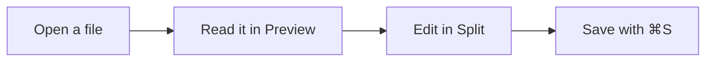

# mdview Manual

mdview is a small native Mac app for reading and editing Markdown and JSON files, a plain text editor for everything else, and a PDF reader where you can highlight and annotate. Markdown appears as a clean, readable document; JSON appears as a collapsible, colour-coded tree that stays fast on multi-megabyte files. Either kind of file can be edited in a native Mac text editor next to a live preview, and Markdown can also be edited visually, like a word-processor document, with mdview writing the Markdown for you.

mdview works offline, follows the macOS light and dark appearance, and needs macOS 14 or later on an Apple Silicon Mac. If you add a Claude or OpenAI API key, you can also ask an AI about the open document and have it make changes for you (see [Asking AI](#asking-ai)); that is the only feature that goes online.

> [!TIP]
> This manual is a Markdown file shown in mdview itself, so everything it describes works here too. Use the contents sidebar on the left (⌃⌘S shows or hides it), or press ⌘F to search.

**Contents**

1. [Installing mdview](#installing-mdview)
2. [Opening files](#opening-files)
3. [The document window](#the-document-window)
4. [Reading Markdown](#reading-markdown)
5. [Exploring JSON](#exploring-json)
6. [Editing](#editing)
7. [Visual editing](#visual-editing)
8. [Plain text and code](#plain-text-and-code)
9. [Fastly VCL](#fastly-vcl)
10. [PDFs](#pdfs)
11. [Asking AI](#asking-ai)
12. [Working with files](#working-with-files)
13. [Reading comfort](#reading-comfort)
14. [Keyboard shortcuts](#keyboard-shortcuts)
15. [What mdview remembers](#what-mdview-remembers)
16. [Privacy and safety](#privacy-and-safety)
17. [Troubleshooting](#troubleshooting)
18. [Limits](#limits)

## Installing mdview

### From a release

1. Download `mdview-<version>.dmg` from [mdview's releases](https://github.com/purpleax/mdview-releases/releases/latest).
2. Open it, and in the window that appears drag **mdview** onto the **Applications** folder.
3. Eject the disk image, then open mdview from Applications.

Releases signed and notarized by Apple open straight away. If a release isn't notarized (the release notes say so), macOS blocks the first launch with a message that it can't check the app. To allow it, do one of these:

- Open **System Settings › Privacy & Security**, scroll down to the message about mdview, and click **Open Anyway**.
- Or run this once in Terminal:

  ```bash
  xattr -d com.apple.quarantine /Applications/mdview.app
  ```

After that, mdview opens normally.

### Updating

Choose **mdview › Check for Updates…**. mdview asks GitHub whether there's a newer version: if there is, it shows what's new, and **Download** downloads it in your browser. Open the downloaded file and drag mdview to Applications again, choosing **Replace**. Your settings, recent files and reading positions are kept. mdview checks only when you choose this command. A copy that isn't notarized needs allowing once, as above.

### Quick Look previews

mdview includes a Quick Look extension, so pressing space on a Markdown or JSON file in Finder shows it rendered. macOS finds the extension once mdview is in Applications and has been opened once. See [Quick Look](#quick-look).

## Opening files

mdview opens:

| Kind | Extensions | Shown as |
| --- | --- | --- |
| Markdown | `.md`, `.markdown`, `.mdown`, `.mkd` | A formatted document |
| JSON | `.json` | A collapsible tree |
| PDF | `.pdf` | The pages, with highlights and notes you add (see [PDFs](#pdfs)) |
| Any other text | `.txt`, `.py`, `.sh`, `.yaml`, `.log`, `Makefile`, … | Plain text (editor only; see [Plain text and code](#plain-text-and-code)) |

mdview goes by the file's name. The one time it looks inside: when the name doesn't say what the file is (no extension, `.txt`, or an extension it doesn't know, such as `.log` or `.out`) and the whole file is valid JSON (an object `{…}` or array `[…]`), it opens as JSON. Files with a known type, such as `.yaml` or `.py`, always open as that type.

Ways to open a file:

- **Finder:** right-click the file and choose **Open With › mdview**.
- **Drag and drop:** drop a file onto mdview's Dock icon or onto any mdview window.
- **File › Open…** (⌘O), or **File › Open Recent**.
- **Links:** a link in a Markdown document to another local `.md`, `.json` or `.txt` file opens that file in mdview.

When mdview starts with nothing to open, and when you click its Dock icon with no windows open, it opens a blank plain-text document, ready to type in. Before you type anything, the **Text | Markdown | JSON | VCL | PDF** switch at the bottom left of the window turns it into a Markdown document (with a live preview), a JSON document (with the tree) or a Fastly VCL document (with its outline) instead; the switch is there on any new, empty document and disappears once you start typing. **PDF** works a little differently, since a PDF can't be started from scratch: it shows a PDF you already have open, or, if none is open, asks you to choose one (which then takes the blank document's place). If you open a file while that blank document is still empty, the file takes its place, so you aren't left with an extra empty window.

The switch is also on every other document (turn off **Always show the document type switch** in **mdview › Settings…** to show it only on new, empty documents). Clicking another type there changes the document you're looking at, keeping its text: a text file becomes Markdown with a preview, Markdown becomes plain text, and so on. A saved file keeps its name and extension, and opens as its usual type the next time; to keep the new type, save it under a matching name (for example `.md`). A PDF's switch shows PDF and can't change it.

**Making mdview the default.** mdview offers itself in **Open With** without taking over your current default app. To always open a type of file in mdview, select one such file in Finder, press ⌘I, choose **mdview** under **Open with**, and click **Change All…**.

**Several documents in one window.** Files you open, create or import go into the front window. With one document, the window is just that document. With two or more, a **document list** appears on the left, as in BBEdit:

- Click a document in the list to show it. Each document keeps its own view (Preview, Split, Source or Visual), scroll position and undo history.
- A dot after a name means it has unsaved changes. Hover a row and click its **×** to close that document.
- Right-click a document for **Close**, **Show in Finder**, **Copy Path** and **Move to New Window**, which gives the document a window of its own.
- **Window › Next Document** (⇧⌘]) and **Previous Document** (⇧⌘[) step through the list.
- **View › Hide Document List** (⌥⌘L) hides it in every window; **Show Document List** brings it back. Drag its edge to make it wider or narrower; all windows follow.

**File › Close** (⌘W) closes the document you're looking at; the window closes with its last document. **File › Close Window** (⇧⌘W), or the window's close button, closes all its documents, saving each one's changes (an untitled document asks whether to save). Opening a file that is already open shows it.

**New documents.** **File › New Markdown Document** (⌘N) and **File › New JSON Document** (⌥⌘N) open an untitled document ready for typing. See [Editing](#editing).

**Importing.** **File › Import…** converts an HTML page, a Word document (`.docx` or `.doc`), an RTF file or an OpenDocument text file (`.odt`) into a new, untitled Markdown document. See [Importing documents](#importing-documents).

> [!NOTE]
> mdview reads files as UTF-8 text. A file that contains binary data is refused with a message rather than shown as garbage.

## The document window

Every window has three parts:

- **The toolbar** at the top, with the **Preview / Split / Source** control in the middle and **ⓘ Document Info** on the right.
- **The preview** (the rendered document or JSON tree), with its own bar of navigation controls.
- **The source editor**, with line numbers and, below it, a status bar showing the caret position and a word count or the JSON check.

The control in the toolbar (or the View menu) chooses which of these you see:

| View | Shortcut | Shows |
| --- | --- | --- |
| Preview | ⌘1 | Only the rendered document. Files open this way at first. |
| Split | ⌘2 | The editor on the left and a live preview on the right, labelled **Markdown source** (or **JSON source**) and **Preview**. For Markdown, both sides can be edited: type in either and the other follows |
| Source | ⌘3 | Only the editor |
| Visual | ⌘4 | The formatted document, editable directly (Markdown only; see [Visual editing](#visual-editing)) |

mdview remembers the last view you chose, separately for Markdown and for JSON, and each window keeps its own view when macOS reopens it. Drag the divider in Split view to change the proportions.

**Customizing the toolbar.** **View › Customize Toolbar…** lets you rearrange the items or add a **Format JSON** button. **View › Show Toolbar** (⌥⌘T) hides or shows the toolbar.

## Reading Markdown

mdview renders GitHub-Flavoured Markdown, the variant used on GitHub, with the same engine GitHub uses.

### Moving around a document

**Contents sidebar.** The sidebar lists every heading, nested under its parent. The top two levels start open; click ▸ to open deeper ones. Click an entry to jump to that heading. As you scroll, the section you are reading is highlighted. The sidebar appears automatically when a document has at least two headings; ☰ in the bar, or **View › Toggle Sidebar** (⌃⌘S), shows or hides it, and mdview remembers your choice. In a narrow window the sidebar opens over the document and closes after you pick an entry.

**Breadcrumb.** The bar at the top of the document shows where you are, such as *guide.md › Install › Requirements*. Click any part to jump to that heading; click the file name to go to the top.

**Back and Forward.** Jumps within a document are recorded: following a `#section` link, a footnote or its ↩ back-link, a contents entry or a breadcrumb. **Go › Back** (⌘[) returns to where you were and **Go › Forward** (⌘]) goes forward again. The ← and → buttons in the bar, and ⌥← / ⌥→, do the same.

**Picking up where you left off.** When you reopen a file, mdview returns to the section you were reading, even if the text above it has changed size.

### Links

| Link | What happens |
| --- | --- |
| `#a-heading` in the same document | Scrolls to that heading (and is recorded for Back) |
| `https://…`, `http://…`, `mailto:…` | Opens in your default browser or mail app |
| A relative link to a `.md`, `.json` or `.txt` file | Opens that file in mdview |
| A relative link to any other file | Opens it in its default app |
| A relative link to a file that doesn't exist | Beeps |

Headings get the same anchors as on GitHub: lower-case, punctuation removed, spaces turned into hyphens, and `-1`, `-2` added to repeated headings. So `## Install & Run` is `#install--run`.

**Copying a link to a section.** Hover a heading and click the **#** that appears in the left margin. mdview copies a Markdown link to that section, such as `[Install](#install)`, ready to paste into the same document. ⌥-click the **#** to copy `file.md#install` instead, for linking from another file. A "Copied" badge confirms it.

### Finding text

Press ⌘F while the preview has the focus to open the find bar. Every match is highlighted and the bar shows *n / total*. Press Return or ⌘G for the next match, ⇧Return or ⇧⌘G for the previous one, and Esc (or **Done**) to close the bar. The search ignores case.

When the editor has the focus, ⌘F opens the editor's own find bar instead (see [Editing](#editing)).

### What Markdown can contain

Everything in GitHub-Flavoured Markdown renders:

- Headings, paragraphs, **bold**, _italic_, ~~strikethrough~~ and `inline code`
- Bulleted, numbered and nested lists, and task lists (`- [ ]` and `- [x]`)
- Tables, with column alignment from `:---`, `:---:` and `---:`
- Block quotes, horizontal rules and fenced code blocks
- Footnotes[^demo], each with a back-link to where it was used
- Links, plain URLs that become links automatically, and images

[^demo]: Footnotes appear at the end of the document. Click ↩ to go back.

On top of that, mdview adds the following.

**Syntax highlighting.** Code blocks with a language, such as ```` ```swift ```` or ```` ```json ````, are coloured in a GitHub-like palette that follows light and dark mode. Most common languages are recognised, plus Dockerfile, nginx, PowerShell, HTTP, Apache, Protobuf, Scala, Dart, Groovy, Haskell, Elixir and LaTeX. Code blocks without a language stay plain.

```swift
let greeting = "Hello, mdview"
print(greeting)
```

**Copy button.** Hover any code block and click **Copy** to put its code on the clipboard.

**Callouts.** A quote that starts with `[!NOTE]`, `[!TIP]`, `[!IMPORTANT]`, `[!WARNING]` or `[!CAUTION]` becomes a coloured callout, as on GitHub:

```markdown
> [!WARNING]
> Back up your data first.
```

> [!WARNING]
> Back up your data first.

**Diagrams.** A ```` ```mermaid ```` code block is drawn as a diagram: flowcharts, sequence diagrams, class and state diagrams, Gantt charts, pie charts and the rest of Mermaid's types. Diagrams follow light and dark mode. If a diagram has a mistake, its error message appears above the source.



**Maths.** TeX formulas render with KaTeX:

| Write | For |
| --- | --- |
| `$E = mc^2$` | A formula within a line |
| `$$ … $$` on its own lines, or within a line | A displayed formula |
| A ```` ```math ```` code block | A displayed formula |
| `` $`…`$ `` | A formula within a line (GitHub's alternative) |

For example, $e^{i\pi} + 1 = 0$ and

$$
\int_0^1 x^2\,dx = \frac{1}{3}
$$

Prices such as $5 and $10 stay as text: a `$` only starts a formula when there is no space just inside it and the closing `$` isn't followed by a digit. Write `\$` for a literal dollar sign. Dollar signs inside code are never maths.

**Front matter.** A block of `key: value` lines between `---` lines at the very top of a file (as used by Jekyll, Hugo and many note apps) appears as a tidy, collapsible **Front matter** table rather than as stray text.

**Images.** Images can be web addresses or paths relative to the Markdown file, such as ``; mdview loads relative images from the file's folder (and folders above it with `../`). Images from the web need a network connection; everything else works offline.

**HTML.** Common, harmless HTML tags render as they do on GitHub, for example:

- `<details>` and `<summary>` for a section that opens on click
- `<kbd>⌘</kbd>` for keys, `<sub>` and `<sup>`, `<mark>`, `<br>`
- `` with `width`, `height` and `align`, and `<p align="center">` or `<div align="center">`
- Tables, lists and other block elements written as HTML

<details>
<summary>An example of <code>&lt;details&gt;</code></summary>

This text was hidden until you opened it. Press <kbd>⌘</kbd><kbd>F</kbd> to find text.

</details>

Anything that could run code or change the page is removed: scripts, event handlers such as `onclick`, `style` attributes and `<style>` blocks, iframes, forms, embedded objects and `javascript:` links. Other unknown tags are replaced by their text.

### Printing

**File › Print…** (⌘P) prints the document without the sidebar, bars or buttons. **File › Page Setup…** (⇧⌘P) chooses the paper size and orientation. To save a PDF without the Print dialog, use **File › Export as PDF…** (see [Working with files](#working-with-files)).

## Exploring JSON

A JSON file opens as a tree. Each object `{…}` and array `[…]` is a row you can open or close; its row shows the key, the opening bracket and how many items or keys it holds. Keys, strings, numbers and `true` / `false` / `null` each have their own colour.

mdview shows JSON exactly as it is in the file:

- **Keys stay in their original order.** They are never sorted.
- **Numbers are shown as written.** `19.990` stays `19.990`, `1e-7` stays `1e-7`, and very large integers such as `12345678901234567890` are not rounded.
- **Text is shown as text.** HTML inside strings is never interpreted.

### Large files

mdview stays fast on files of many megabytes. Small files open fully expanded; large ones open two levels deep, and each branch is built only when you first open it. Arrays and objects with more than 500 items are split into groups such as `[0 … 499]` that open on demand.

### Opening and closing branches

| To | Do this |
| --- | --- |
| Open or close one branch | Click its row |
| Open or close a branch and everything inside it | ⌥-click its row |
| Show the tree to a given depth | **Level 1 / 2 / 3 / All** in the bar, or ⌥⌘1, ⌥⌘2, ⌥⌘3, ⌥⌘0 |

### Searching and filtering

Press ⌘F or `/` to go to the search box and type. mdview searches keys and values, ignoring case, and highlights the matches. Return (or ⌘G, or ↓) goes to the next match and ⇧Return (or ⇧⌘G, or ↑) to the previous one; each match is revealed with only the branches above it opened. The count shows *n / total*. Esc clears the search.

Tick **Filter** next to the search box to hide everything that doesn't match. Matching branches keep all their contents, and the branches above each match stay visible so you can see where it sits.

### Focus

To look at one branch on its own, hover its row and click **Focus**, or select the row and press F. That branch is shown as if it were the whole file, and searches only look inside it. The breadcrumb shows the levels above in grey; click one to widen the focus. **Go › Exit Focus**, the **Exit focus** button or Esc returns to the whole file.

### The breadcrumb and Copy Path

The second row of the bar shows the path to the item at the top of the view (or the selected row), such as `$ › paths › /orders › post`. Click any part to jump there.

**Go › Copy Path** (⌥⌘C), or the **Copy path** button, copies a JSONPath for the current position, such as `$.paths["/orders"].post`, ready to use in tools such as `jq` or JSONPath libraries.

### Keyboard

| Key | Action |
| --- | --- |
| ↑ / ↓ | Move the selection up or down |
| → | Open the selected branch, or move into it |
| ← | Close the selected branch, or move to its parent |
| Return or Space | Open or close the selected branch |
| F | Focus the selected branch |
| Esc | Exit focus, or clear the search |
| / or ⌘F | Search |

### The sidebar: Outline and Endpoints

☰ in the bar, or ⌃⌘S, shows or hides the sidebar. It has two views, chosen at its top:

- **Outline** works for any JSON file. It lists the objects and arrays (not the individual values) with their sizes. Array items are labelled by a `name`, `title`, `id` or similar field when they have one. Click an item to go to it in the tree; the item you're looking at is highlighted.
- **Endpoints** appears for OpenAPI and Swagger API specifications. It shows the API's title and version, then every operation grouped by tag, with a coloured method badge (GET, POST, …), its path and summary; deprecated operations are struck through. Below the operations, **Components** lists the spec's schemas, responses, parameters and other reusable parts. Clicking any of them focuses it in the tree. The search box filters this list as well.

### `$ref` links

In API specs and JSON Schema files, a value such as `"$ref": "#/components/schemas/Order"` is a link. Click it to jump to what it refers to; ⌘[ brings you back. References to other files, and references to things that don't exist, show a short notice instead.

### Back, Forward and reopening

Jumps (sidebar clicks, breadcrumb clicks, `$ref` links and focus changes) are recorded, so **Go › Back** (⌘[) and **Go › Forward** (⌘]) retrace them. When you reopen a JSON file, mdview returns to the same position and focus.

### Invalid JSON

If a file isn't valid JSON, mdview says so in one line with the position of the problem, for example *Invalid JSON at line 4, column 21: invalid character '}' looking for beginning of value*, and opens it in Split view so you can fix it.

## Editing

Switch to **Split** (⌘2) or **Source** (⌘3) to edit. The editor is a standard Mac text editor, so everything you expect works: undo and redo (⌘Z, ⇧⌘Z), cut, copy and paste, **Edit › Find** with find and replace, spelling and grammar checking, dictation, **Edit › Transformations**, **Edit › Speech** and Services.

- Line numbers run down the left. A long line that wraps is still numbered once.
- The line with the caret is lightly tinted.
- Markdown and JSON are colour-coded as you type, in colours that match the preview.
- Spell checking is on for Markdown and off for JSON.
- Smart quotes and smart dashes are off, so what you type is exactly what is saved.

The status bar under the editor shows the caret position (`Ln 12, Col 5`, plus the number of characters selected) and, on the right, the word count for Markdown or the JSON check.

Changes appear in the preview a moment after you stop typing (a little longer for very large files). The preview keeps its place while it updates.

### Saving and versions

mdview saves the way other Mac document apps do:

- **File › Save…** (⌘S) saves; a new document asks for a name and folder. Markdown documents are saved as Markdown and JSON documents as JSON.
- **Autosave:** your changes are saved automatically as you work, and a dot on the window's close button shows there are changes since you last chose Save.
- **File › Revert To** goes back to the last saved version, or **Browse All Versions…** to pick an earlier one.
- **File › Duplicate** (⇧⌘S), **Rename…** and **Move To…** work as usual; the window follows the file.
- Closing a window with unsaved changes asks whether to save them.

### New documents

**File › New Markdown Document** (⌘N) and **New JSON Document** (⌥⌘N) open in Split view. A new JSON document starts as an empty object with the caret inside it.

### Markdown editing aids

| Command | Shortcut | What it does |
| --- | --- | --- |
| Bold | ⌘B | Wraps the selection in `**…**`, or removes it if it's already bold |
| Italic | ⌘I | Wraps the selection in `_…_`, or removes it |
| Strikethrough | ⇧⌘X | Wraps the selection in `~~…~~`, or removes it |
| Inline Code | ⇧⌘K | Wraps the selection in backticks, or removes them |
| Link… | ⌘K | Turns the selection into `[text](url)` with `url` selected so you can type or paste the address. If the selection is a web address, it becomes the link target and the caret goes into the brackets. |

With nothing selected, Bold, Italic, Strikethrough and Inline Code insert an empty pair with the caret in the middle, ready to type. All of these are in the **Format** menu and each is a single undo step.

**Lists and quotes.** Press Return at the end of a list item to start the next one with the same marker and indentation:

- `- `, `* ` and `+ ` bullets continue as they are.
- Numbered items count up: `1.` is followed by `2.`.
- Task items continue as unchecked tasks: `- [x] Done` is followed by `- [ ] `.
- Quotes continue with `> `.

Press Return on an empty item to end the list (the marker is removed).

**Nesting.** With the caret in a list item, Tab indents it one level and ⇧Tab outdents it. With several lines selected, Tab and ⇧Tab indent or outdent them all. Elsewhere, Tab inserts four spaces.

**Pasting formatted text.** Text copied from a web page, Google Docs, Word, Pages, Notes or mdview's own preview keeps its formatting: mdview pastes it as Markdown, so headings become `#` lines, bold becomes `**…**`, links become `[text](address)`, and lists and tables become Markdown lists and tables. Code copied from a code editor or Terminal pastes exactly as it is. To paste plain text without any conversion, use **Edit › Paste and Match Style** (⌥⇧⌘V).

### JSON editing aids

- Typing `{`, `[` or `"` adds the closing character as well; typing the closing character when it is already there just steps over it. Backspace between an empty pair removes both.
- Return keeps the current indentation. After `{` or `[` it indents two spaces, and between a pair of brackets it opens an empty indented line with the closing bracket on the line below.
- Typing a closing bracket on an empty line moves it back to the right indentation.
- Tab inserts two spaces (or indents the selected lines); ⇧Tab outdents.

### JSON checking

mdview checks your JSON as you type. While it's valid, the status bar says **Valid JSON**. When there's a problem:

- the status bar shows the message in red, such as *Invalid JSON at line 4, column 21: …*;
- a red dot appears beside that line number, and the line is tinted red;
- the preview keeps showing the last valid version, so it doesn't disappear while you're halfway through typing.

Click the message, or choose **Format › Jump to Error** (⌘'), to put the caret right at the problem.

### Format and Minify

**Format › Format JSON** (⌥⇧⌘F) lays the file out neatly with two-space indentation, one item per line. **Format › Minify JSON** puts it all on one line with no spaces. Both keep the keys in their order and every number and string exactly as written; only the spacing changes. Each is one undo step. If the JSON is invalid, mdview beeps and jumps to the error instead.

Minified files that are all on one line are slow to edit; Format JSON first makes them fast.

### Scroll sync and jumping to the source

In Split view, the Markdown preview follows the editor as you scroll, and the editor follows the preview. Double-click anything in the Markdown preview in Preview view to put the caret on its line in the source (mdview switches to Split).

**Editing on either side.** In Split view a Markdown document can be edited in both panes. Type in the source on the left and the formatted page on the right updates; type in the formatted page on the right (with the formatting bar above it, as in [Visual editing](#visual-editing)) and the Markdown on the left is rewritten to match. There is one undo history for both. In the right pane, a click places the caret, so ⌘-click a link to follow it. Read-only documents, such as this manual, stay read-only on the right.

### When another app changes the file

mdview watches each open file. If another app changes it (an external editor, `git pull`, a script):

- **with no unsaved changes**, mdview reloads it straight away and keeps your place, and a brief "Reloaded" message appears;
- **with unsaved changes**, the status bar says the file changed on disk and offers **Reload** (discard your changes and load the file) or **Keep My Changes** (carry on; when you next save, macOS asks whether to overwrite the newer file).

If the file is moved or deleted, a notice says so and the last version stays on screen; when the file comes back, mdview reloads it. If the file is renamed or moved in Finder while it's open, the window follows it.

## Visual editing

Visual mode lets you edit a Markdown document the way you would in a word processor: you work on the formatted page, and mdview writes the Markdown. Choose **View › Visual** (⌘4) or the fourth button of the view control. Visual mode is for Markdown documents; it isn't available for JSON files or for this manual.

Click anywhere in the text and type. Behind the scenes, every change goes straight into the Markdown source, so you can switch to Split (⌘2) at any time to see it, and keep editing visually there with the source alongside. **Only the parts you change are rewritten**: the rest of the file keeps its exact wording, spacing and style.

### Typing and moving around

- **Return** starts a new paragraph; at the end of a heading, the new paragraph is plain text. In a list it starts a new item; on an empty item it ends the list.
- **⇧Return** inserts a line break within a paragraph.
- **Tab** and **⇧Tab** nest and un-nest list items, and move between table cells.
- **Backspace** at the start of a paragraph joins it to the one above.
- Click a task checkbox to tick or untick it.
- Links don't open when you click them, so you can edit their text; **⌘-click** follows a link.

### Markdown shortcuts

At the start of a paragraph, type one of these and then a space to change the paragraph:

| Type | To get |
| --- | --- |
| `#` to `######` | A heading, level 1 to 6 |
| `-`, `*` or `+` | A bulleted list |
| `1.` | A numbered list |
| `>` | A quote |
| `[ ]` or `[x]` (in a list item) | A task item |

Type ```` ``` ```` (optionally followed by a language, such as ```` ```swift ````) or `---` on its own and press Return to start a code block or insert a horizontal rule.

### The formatting toolbar

In Visual mode a toolbar appears at the top of the document:

| Control | What it does |
| --- | --- |
| Paragraph style | Paragraph, Heading 1–6, Quote or Code Block for the paragraph with the caret |
| **B**, *I*, ~~S~~ | Bold, italic, strikethrough (⌘B, ⌘I, ⇧⌘X) |
| `</>` | Inline code (⇧⌘K) |
| Link | Add a link to the selection, or edit or remove the link under the caret (⌘K) |
| • —, 1. —, ☑ — | Bulleted, numbered or task list |
| ⇤ ⇥ | Outdent, indent |
| ― | Horizontal rule |
| Table… | Insert a table; add a row above or below, a column left or right; delete a row, column or the table |

The Format menu commands work in Visual mode too.

### Diagrams, formulas and other special blocks

Some parts of a document can't be edited as formatted text: Mermaid diagrams, maths formulas, raw HTML (such as `<details>`), front matter and footnotes. Hover one and a dashed outline appears; click it to open a sheet with its source. Edit it and click **Done**, or click **Remove** to delete it. For a formula within a line, the sheet shows just its TeX.

### Undo, saving and the other views

Visual mode shares one undo history with the source editor: **Edit › Undo** (⌘Z) undoes your last change in either view. Saving, autosave, Versions and closing work as usual, and mdview always includes the very last characters you typed. Find (⌘F) searches the document.

### Pasting

Formatted text pasted into Visual mode keeps its headings, bold, italic, links, lists, tables and code, and becomes Markdown. Plain text pastes as text. **Edit › Paste and Match Style** (⌥⇧⌘V) pastes without formatting.

### What changes in the Markdown

When you edit a paragraph, mdview writes that paragraph in a consistent style: `**bold**`, `*italic*`, `~~strike~~`, `#` headings and fenced code blocks. Lists keep their bullet (`-`, `*` or `+`), code blocks keep their fence, tables keep their alignment row, and links keep using a `[label]: address` definition when the document has one. Characters that would otherwise be read as Markdown, such as a `*` or `_` that isn't emphasis, get a backslash. A line break typed with ⇧Return is written as a backslash at the end of the line. Inline HTML in an edited paragraph is kept for tags such as `<kbd>`, `<sub>`, `<sup>` and `<mark>`; HTML that mdview doesn't show (scripts, styles, event handlers) is dropped from that paragraph.

## Plain text and code

mdview is also a plain text editor. Anything that isn't Markdown or JSON (a Python script, a shell script, a `.yaml` or `.conf` file, a log, a `.txt`, a `Makefile` or any other file with no extension) opens as **plain text**: just the editor, with no preview, so the view buttons other than Source are greyed out. Return keeps the current line's indentation.

### Code colouring

Code is coloured as you'd expect from a programmer's editor: keywords in red, strings in dark blue, comments in grey, numbers and constants in blue, types in orange and function calls in purple (lighter shades in dark mode). mdview works out the language from the file's name (`.py`, `.swift`, `Makefile`, `Dockerfile`…) or, for a script with no extension, from its first line (`#!/bin/bash`, `#!/usr/bin/env python3`), which is picked up as soon as you type it. When Ask AI writes code into a new text document, it sets the language too.

It knows Swift, Python, JavaScript, TypeScript, shell, Go, Rust, C, C++, Objective-C, Java, Kotlin, C#, Ruby, PHP, Lua, SQL, HTML, XML, CSS, SCSS, YAML, TOML, INI, Makefile, Dockerfile, diff and Fastly VCL (`.vcl` files open as their own document type: see [Fastly VCL](#fastly-vcl)).

The language's name is shown at the right of the status bar. Click it (or use **Text › Language**) to pick another language, or **Plain Text** for no colouring; the choice lasts while the document is open. Comment / Uncomment uses the chosen language's comment marker.

Colouring works out of what it sees, without understanding the program, so an unusual construct can occasionally be coloured oddly. It only colours the part of the file on screen, so even very large files stay quick.

**File › New Text Document** (⌥⇧⌘N) starts an empty plain-text document. When you save it, give it any name and extension: `notes.txt`, `backup.sh`, `Dockerfile`. If it is coloured as a language, Save suggests a name with that language's extension, such as `Untitled.py`.

### Encodings and line endings

Text files are stored in an **encoding** (how characters become bytes) and with **line endings** (how lines are separated). mdview works them out when it opens a file and saves the file the same way, so files from Windows or older Macs come back exactly as they went in.

The right-hand end of the status bar shows both, for example **UTF-8** and **CRLF**. Click one to change it (the same menus are in the **Text** menu):

- **Line endings:** LF (macOS and Linux), CRLF (Windows) or CR (classic Mac OS). The change is saved with the file and can be undone.
- **Text Encoding › Save As Encoding** saves the file in another encoding from now on, such as UTF-8. If the text has characters that encoding can't hold (an emoji in a Western file, say), mdview says so and keeps the current one.
- **Text Encoding › Reopen Using Encoding** reads the file again as if it were in another encoding. Use it when accents or symbols look wrong (`café` instead of `café`): the file was guessed wrong, and reopening it as the right encoding fixes it. Unsaved changes are lost, so mdview asks first.

mdview recognises UTF-8, UTF-16 and UTF-32 (with or without a byte-order mark), and older encodings such as Windows Latin 1, ISO Latin 1 and Mac OS Roman. Files that aren't text at all (images, programs) are refused with "looks like a binary file, not text".

### Indentation

The status bar's **Spaces: 4** or **Tab Width: 4** (also **Text › Indentation**) sets how Tab indents:

- **Indent Using Spaces** on: Tab inserts spaces; off: Tab inserts a tab character.
- **Tab Width** (2, 3, 4 or 8): how many spaces a level of indentation is, and how wide tab characters look.

With several lines selected, Tab indents them all and ⇧Tab outdents them. The settings are remembered separately for Markdown, JSON and plain text. Out of the box, Markdown uses 4 spaces, JSON 2 spaces and plain text tabs 4 wide.

### Line commands

The **Text** menu works on the lines the selection touches (or the line with the caret):

| Command | Shortcut | What it does |
| --- | --- | --- |
| Comment / Uncomment | ⌘/ | Adds the file's comment marker to the lines, or removes it if they all have one: `#` for Python, shell, YAML and Makefiles, `//` for Swift, JavaScript, C, Go and Rust, `--` for SQL, `<!-- -->` for HTML, XML and Markdown, `/* */` for CSS, and so on |
| Duplicate Line | ⇧⌘D | Copies the lines below themselves |
| Move Line Up / Down | ⌃⌘↑ / ⌃⌘↓ | Moves the lines past the one above or below |
| Sort Lines | | Sorts the selected lines A to Z, with numbers in natural order (`file2` before `file10`); with no multi-line selection, the whole document |
| Sort Lines Descending | | The same, Z to A |
| Remove Duplicate Lines | | Keeps the first of any repeated lines |

Each is a single undo step.

### Seeing and wrapping text

- **View › Show Invisibles** (⌥⌘I) marks spaces `·`, tabs `→` and line ends `¬`, so stray whitespace shows up. The marks are only on screen, not in the file.
- **View › Soft Wrap** (⌥⌘\\) is on by default: long lines wrap at the edge of the window. Turn it off to keep each line on one row and scroll sideways.
- **Go › Go to Line…** (⌘L) jumps to a line number, or to `line:column` such as `120:8`.

These settings apply to every window and are remembered.

### Making mdview your text editor

mdview appears in **Open With** for every text file, but never makes itself the default. To use it for a kind of file, select one such file in Finder, press ⌘I, choose **mdview** under **Open with**, and click **Change All…**.

## Fastly VCL

Fastly VCL files (`.vcl`), the configuration language of Fastly's CDN, are a document type of their own: an editor with VCL colouring, an outline of the file, and checks for common mistakes. Everything works offline; mdview doesn't connect to Fastly.

### Opening and creating VCL

- `.vcl` files open as VCL (mdview is offered in **Open With** for them).
- **File › New VCL Document** (or **VCL › New VCL Document**) starts an empty VCL document.
- **VCL › New Snippet ▸** starts a snippet for one subroutine (`vcl_recv`, `vcl_fetch`…, or `init` for code outside subroutines). Its first line names the type.
- A new, empty document can be switched to VCL with **VCL** in the status bar's type switch.

VCL documents use 2-space indentation by default; the status bar changes it, as for other documents.

### The outline

The outline on the left lists the file's subroutines in the order Fastly runs them (`vcl_recv`, `vcl_hash`, `vcl_hit`, `vcl_miss`, `vcl_pass`, `vcl_fetch`, `vcl_error`, `vcl_deliver`, `vcl_log`), then your own subroutines, tables, ACLs, backends and directors. All nine are always listed, even in a new document; those the file doesn't define yet are shown dimmed. Click an entry to go to it. **View › Hide Outline** (⌃⌘S) hides it for all VCL documents.

### Colouring

Keywords (`sub`, `if`, `set`, `return`, `table`…), subroutine names, variables (`req.http.Host`, `beresp.ttl`, `client.geo.country_code`…), functions (`regsub()`, `table.lookup()`), strings including long strings `{"…"}`, times such as `3600s`, comments (`#`, `//`, `/* */`) and the `#FASTLY` lines each have their own colour.

### Checks

As you type, mdview checks for common mistakes and marks them in the line numbers: a red dot for an error, an amber dot for a warning. The status bar shows how many there are, and the message for the line the cursor is on. **VCL › Next Problem** (or ⌘', or a click on the message) goes to the next one.

It checks for:

- braces that don't match;
- subroutine names starting `vcl_` that Fastly doesn't have;
- a lifecycle subroutine in a custom VCL file without its `#FASTLY` line (Fastly's generated VCL for it would be skipped);
- `beresp.` used outside `vcl_fetch`, `resp.` outside `vcl_deliver` and `vcl_log`, and `obj.ttl` outside `vcl_hit`;
- a time without a unit (`set beresp.ttl = 86400;` instead of `86400s`);
- `req.request` (use `req.method`) and `return(purge)`, which Fastly doesn't have;
- `synthetic "…"` instead of `synthetic {"…"}`;
- Vary set in `vcl_deliver`, or replaced outright in `vcl_fetch`.

These catch common mistakes; they aren't Fastly's compiler, so a file with no problems shown can still be rejected by Fastly.

### Snippets

**VCL › Insert Snippet ▸** puts a ready-made recipe at the cursor, as one undo step: redirects from a table, a cache-status header (HIT / MISS / PASS), appending to Vary, serving stale content, detecting grace, not caching a path, setting a TTL, not caching responses that set cookies, CORS headers, blocking countries, allowing only an ACL, reading a cookie, forcing HTTPS, a synthetic response and removing response headers. Each starts with a comment saying which subroutine its parts belong in.

### Asking AI about VCL

With a VCL document open, Ask AI (⌥⌘K) is told it's Fastly VCL and follows Fastly's rules, so you can ask *"explain what this does on a cache miss"* or *"redirect /old to /new"* and get Fastly-correct answers and edits.

## PDFs

mdview opens PDF files, so a manual, a paper or a spec can sit in the same window (and document list) as the notes you're writing about it. You can read a PDF and mark it up with highlights, notes, text boxes, shapes and drawings (see [Marking up PDFs](#marking-up-pdfs)); mdview never changes the PDF's own text or pages. mdview appears in **Open With** for PDFs, but Preview stays your default PDF app unless you change it.

### The PDF toolbar

A toolbar runs along the top of a PDF:

| Control | What it does |
| --- | --- |
| Sidebar button | Shows or hides the sidebar (also ⌃⌘S) |
| ˄ ˅ and the page number | Previous and next page; type a page number and press Return to go there |
| Zoom out / zoom in | Steps through 50%, 75%, 100%, 125%, 150%, 200%, 300% and 400% (also ⌘− and ⌘+) |
| Zoom menu | Shows the current zoom; choose **Fit Width**, **Fit Page** (the whole page in view, even as you resize the window), **Actual Size** (100%) or a percentage |
| Magnifying glass | Find (also ⌘F) |

### Moving around

- Scroll through the pages, or use the **sidebar**: **Contents** lists the PDF's own table of contents (its bookmarks), when it has one; click an entry to go there. **Pages** shows a thumbnail of every page. **Notes** lists the PDF's highlights and notes (see [The Notes list](#the-notes-list)). **View › Toggle Sidebar** (⌃⌘S) shows or hides the sidebar.
- **Go › Go to Page…** (⌘L) jumps to a page number.
- Links inside the PDF work. **Go › Back** (⌘[) and **Forward** (⌘]) retrace your jumps.
- The status bar shows the page you're on ("Page 5 of 19") and the zoom.
- When you reopen a PDF, mdview returns to the page you were on.

### Finding and copying text

Press ⌘F to open the find bar and type. Every match is highlighted; the count shows *n / total*. Press Return or ⌘G for the next match, ⇧Return or ⇧⌘G for the previous one, and Esc or **Done** to close the bar. Select text with the mouse and copy it with ⌘C (unless the PDF forbids copying).

### Zoom

The toolbar's zoom controls, or **View › Zoom In** (⌘+) and **Zoom Out** (⌘−), change the PDF's size; **View › Actual Size** (⌘0) fits the page width to the window again. This zoom is the PDF's own; it doesn't change the text size of your other documents.

### Marking up PDFs

A second toolbar, always shown under the first, holds the markup tools:

| Tool | How to use it |
| --- | --- |
| Select (arrow) | Click a mark to select it; drag to move it; drag a corner of a box, oval or text box to resize it, or an end of a line or arrow to move that end. Double-click a note or text box to change its text. |
| Highlight, Underline, Strikethrough | Select text: it is marked as you let go of the mouse, and the tool stays on for the next selection. With text already selected, choosing the tool marks just that text and goes back to Select. |
| Note | Click where the note should go and type in the box that opens; click elsewhere (or press Esc) to finish. The note shows as a small icon; double-click it to read or change it. |
| Text Box | Click (or drag across, to set the width) and type. Text boxes print and show in every PDF app. An empty text box isn't kept. |
| Rectangle, Oval, Line, Arrow | Drag from one corner (or end) to the other. A click without dragging makes one of a standard size. |
| Draw | Drag to draw freehand. |

While a tool is on, the status bar says which one and how to use it. A tool stays on until you press Esc, click its button again, or choose another. The menus on the right of the row set the **colour** (yellow, green, blue, pink, purple, red or black), the **line width** of shapes and drawings, and the **text size** of text boxes. With a mark selected they change that mark; otherwise they set what the next one will look like (each tool remembers its own colour). The bin button, ⌫ or **Edit › Delete** removes the selected mark.

From the keyboard and menus, with text selected in a PDF: **Format › Highlight** (⌃⌘H), **Format › Underline** (⌃⌘U) and **Format › Strikethrough** (⇧⌘X) mark it once. With nothing selected, these turn the tool on instead; press the shortcut again (or Esc) to turn it off.

Marks you add are standard PDF annotations, so Preview, Acrobat, browsers and other PDF apps show them, and mdview shows and lets you change marks made in other apps too. Like other apps, mdview records your Mac user name as each new mark's author.

### Saving a marked-up PDF

A PDF you have marked up saves like your other documents: ⌘S, or automatically as you work, with **Undo** (⌘Z) for every change and **File › Revert To** to go back to an earlier version, including the PDF as it was before you changed it. A long PDF (more than 300 pages) takes a moment to write, so mdview saves it automatically at most once a minute; ⌘S, closing and quitting still save straight away. Until you change a PDF, mdview never rewrites it.

Saving rewrites the PDF through macOS's PDF engine, which can change the file's size and doesn't always keep everything a specialised PDF tool put there (for example, accessibility tags). Keep a copy if the original matters (**File › Duplicate** before you start, or **Revert To** afterwards).

Some PDFs can't be changed:

- A **password-protected or restricted** PDF can be read but not marked up: saving it would remove the protection. mdview says so when you try.
- A PDF whose author **doesn't allow comments** can't be marked up.
- A PDF with a **digital signature** can be marked up, but mdview asks first: any change makes the signature invalid.

### The Notes list

The sidebar's **Notes** tab lists every highlight, note, text box and shape, page by page, with the words you highlighted or the note's text. Click one to go to it and select it.

**File › Export Notes as Markdown…** turns the highlights and notes into a new Markdown document: a heading for each page, each highlight as a quote, and each note or text box as a list item. Shapes and drawings are left out. Save it next to the PDF (mdview suggests that folder) and each page heading becomes a link that opens the PDF at that page.

### Information, printing and files

- **View › Document Info** (⇧⌘I) shows the PDF's title, author, subject, number of pages, PDF version, the app that made it, its dates, whether it's protected, its size and where it is.
- **File › Print** (⌘P) prints it, with its marks.
- **File › Rename…**, **Move To…**, **Duplicate**, **Show in Finder** and **Open in** *Preview* (or the app you choose) work as for other documents.
- A password-protected PDF asks for its password when it opens.
- If another app changes the PDF while it's open, mdview reloads it and stays on the same page (if you have unsaved marks, mdview asks which version to keep).
- A link in Markdown to a PDF opens it in mdview; a link ending `#page=12` opens it at page 12.

## Asking AI

Ask AI puts an AI model in a panel beside the document: **Claude**, from Anthropic, or **GPT**, from OpenAI. Ask it about what you're reading (summaries, explanations, what a JSON file contains, where a PDF says something) or ask it to change the document, and it makes the changes in the editor for you.

It uses your own API key, so usage is charged to your Anthropic or OpenAI account. Nothing is sent until you ask a question.

### Setting it up

1. Create an API key: in the [Claude Console](https://platform.claude.com/) for Claude, or the [OpenAI dashboard](https://platform.openai.com/api-keys) for GPT. You need an account with API credit (a ChatGPT or Claude subscription doesn't include API use).
2. Choose **mdview › Settings…** (⌘,), pick the **Provider**, paste the key into **API key** and click **Save**. mdview checks it and says whether it works.

Each provider keeps its own key, so you can save both and switch between them with **Provider**. Keys are kept in your Mac's keychain, not in mdview's settings, and each is only ever sent to its own provider. **Remove** deletes the shown provider's key.

In Settings you can also choose:

- **Model**, for each provider:
  - Claude: **Claude Opus 5.5** (the default, the most capable), **Claude Sonnet 5.5** (faster, half the price) or **Claude Haiku 5.5** (fastest and much cheaper, good for quick questions).
  - GPT: **GPT-6 Astra** (the default, the most capable), **GPT-6.1 Sol** (nearly as capable for a fifth of the price) or **GPT-6 Luna** (fastest and much cheaper).
- **Effort:** how much the model thinks before answering. **Medium** suits most questions; **High** can help with hard ones but is slower and costs more; **Low** is quickest.

### Asking a question

**View › Show Ask AI** (⌥⌘K), or the speech-bubbles button in the toolbar, opens the panel on the right of the window. The model in use is shown at the top. Type a question and press Return (⇧Return starts a new line), or click one of the suggested questions. The first time for each provider, mdview asks you to confirm that documents are sent to it.

The answer appears as it's written, formatted like a Markdown document. While it's being written, the send button becomes a stop button (or press Esc). Under each answer:

- **Copy** copies the answer's Markdown.
- **Insert** puts the answer into the document at the cursor (Markdown, JSON and text documents), switching to Split view so you can see it. Edit › Undo removes it.
- **Try Again** appears if the last question failed or was stopped.
- The model that answered is shown on the right.

Follow-up questions continue the conversation, and you can switch provider or model between questions. Each document has its own conversation, kept while the document is open; the panel shows the one for the document on screen. The **New Conversation** button (top of the panel) starts again.

**View › Ask AI About Selection** (⌥⇧⌘K) opens the panel with the text you've selected (in the editor, the preview or a PDF) quoted in the question box, ready for you to add your question.

### Having the AI change the document

Ask for any change in plain words (*"fix the spelling"*, *"rewrite the introduction to be shorter"*, *"add a table of the endpoints"*, *"translate this into French"*, *"sort the keys"*) and the model makes it in the editor:

- The panel shows **Editing the document** while it works, then a note of how many changes it made.
- The changed text is selected in the editor and the preview updates straight away.
- Each set of changes is one step in **Edit › Undo** ("Undo Claude's Edits" or "Undo GPT's Edits"), so you can step back through them. Nothing is saved until mdview saves the document as usual.
- The document changes only when you ask for a change; questions just get answers.
- When the model writes code into a plain-text document (*"write a Python script that…"*), it also sets the colouring language, so the script is coloured straight away and Save suggests a name like `Untitled.py`.

PDFs and read-only documents (such as this manual) can't be changed; the model gives the new text in its answer instead.

### What is sent

When you ask a question, mdview sends, to the chosen provider only:

- the whole document as it is in the editor, including changes you haven't saved (a PDF is sent as the PDF itself, so the model sees its layout, tables and images), and its name;
- your question and the conversation so far.

Nothing else is sent: not other documents, not the file's location, not images a Markdown document links to. OpenAI is asked not to store the conversation (each request carries everything it needs).

If you change the document between questions, the model sees the new version with your next question.

### Costs

Charges depend on the provider, the model and the size of the document. As a guide, for a 10,000-word document (about 15,000 tokens):

| Model | First question | Each follow-up |
| --- | --- | --- |
| Claude Opus 5.5 | about 8 cents | well under a cent while the document stays the same |
| GPT-6 Astra | about 15 cents | less, as OpenAI discounts repeated text automatically |
| Claude Haiku 5.5, GPT-6 Luna | a fraction of a cent | a fraction of a cent |

The answer itself adds a few cents with the larger models (the model's thinking counts as output).

Before sending a very large document (more than about 100,000 tokens, roughly 75,000 words) mdview tells you its size and the cost of the first question, and asks you to confirm. The models can read documents of up to about a million tokens, and PDFs of up to 600 pages. A PDF over about 23 MB (usually because of large pictures) is sent as each page's text plus a smaller picture of the page, which the model reads just as well for most questions.

### If something goes wrong

- **"Your API key wasn't accepted"**: check or replace the key in Settings (for the provider shown).
- **"Your OpenAI account has run out of credit"**: add credit in the OpenAI dashboard.
- **"You're over your API rate limit"** or **"… is overloaded"**: wait a moment and click **Try Again**.
- **"Couldn't reach Anthropic"** (or OpenAI): check your internet connection.
- **"… declined to answer"**: occasionally a model's safety checks decline a request, sometimes mistakenly. Rephrasing usually helps; with Claude Opus or Sonnet, mdview automatically retries a declined request on another Claude model first.

## Working with files

### Importing documents

**File › Import…** turns documents from other apps into Markdown. Choose one or more files:

| File | What comes across |
| --- | --- |
| HTML (`.html`, `.htm`) | Headings, paragraphs, bold, italic, links, lists, tables, code and quotes |
| RTF (`.rtf`, `.rtfd`) | Headings (from text size), bold, italic, strikethrough, links, lists, tables and monospaced text as code |
| Word (`.docx`, `.doc`), OpenDocument (`.odt`) | Headings, bold, italic, lists and monospaced text as code; tables and links are not kept |

Each file opens as a new, untitled Markdown document named after it. Save it where you want it (⌘S). Images aren't imported; images in an HTML file that use relative paths work again once the Markdown file is saved in the same folder as the HTML file.

### Open in an external editor

**File › Open in *Editor*** (⇧⌘E) opens the file in another app, named in the menu (for example *Open in BBEdit*). Unsaved changes are saved first. mdview picks up the changes you make there when you save them.

The app used is, in order: the one you picked with **File › Choose External Editor…**; otherwise the file's default app, unless that is mdview; otherwise another app that can open it; otherwise TextEdit. The choice is remembered separately for Markdown and for JSON.

### Show in Finder

**File › Show in Finder** (⌥⌘R) opens a Finder window with the file selected.

### Export as HTML

**File › Export as HTML…** (Markdown documents) saves a single, self-contained web page: highlighted code, diagrams, formulas and the images from your folder are all included, and it contains no scripts. It opens in any browser without a network connection and follows the reader's light or dark setting.

### Export as PDF

**File › Export as PDF…** saves a paginated PDF of the document as it would print, without going through the Print dialog. It works for Markdown and for the JSON tree, which is exported as currently opened and closed.

Both exports suggest the document's own name and folder.

### Quick Look

In Finder, select a Markdown or JSON file and press space to see it rendered, using the same styles as the app. The preview is read-only, with the sidebar closed and links switched off. Two things only work in the app: Mermaid diagrams show as their source, and images with relative paths don't load.

## Reading comfort

### Text size

**View › Zoom In** (⌘+) and **Zoom Out** (⌘−) change the text size from 50 % to 300 %, and **Actual Size** (⌘0) resets it. The size applies to the preview and the editor in every window, and is remembered.

### Wide Layout

**View › Wide Layout** widens the Markdown reading column and lets the JSON tree use the whole window. It applies to every window and is remembered.

### Document Info

**View › Document Info** (⇧⌘I), or ⓘ in the toolbar or the preview's bar, shows facts about the document:

- **Markdown:** words (prose only: code, diagrams, maths and front matter aren't counted), reading time, headings, links (to the web, within the document and to files), and, where present, images, code blocks, tables, diagrams, formulas and footnotes.
- **JSON:** for API specs, the format and the number of paths and operations; then the number of values, the nesting depth, objects (and their keys), arrays (and the largest one), strings, numbers and `true` / `false` / `null`.
- **Both:** file size, number of lines, when the file was last modified, and where it is.

Press Esc, click **Done** or click outside the panel to close it.

### Appearance

mdview follows the macOS light or dark setting. To choose for mdview alone, use **View › Appearance › Light** or **Dark**; **Use System Setting** goes back to following macOS.

### Background

**View › Background** puts a soft tint behind the text: **Paper** (warm cream), **Sepia**, **Mint**, **Sky** (pale blue), **Lavender** or **Grey**; **None** goes back to the usual white (or dark) background. The tint covers the editor, its line numbers and the preview, in every window, and is remembered. Each tint has a dark version, so it works with dark mode too. Printing, **Export as HTML** and **Export as PDF** still use a white page, and PDFs keep their own pages.

### Full screen

**View › Enter Full Screen** (⌃⌘F, or the green window button) gives a document the whole screen.

## Keyboard shortcuts

### File

| Shortcut | Command |
| --- | --- |
| ⌘N | New Markdown Document |
| ⌥⌘N | New JSON Document |
| ⌥⇧⌘N | New Text Document |
| ⌘O | Open… |
| ⌘W | Close (the shown document) |
| ⇧⌘W | Close Window (all its documents) |
| ⌘S | Save… (also a marked-up PDF) |
| ⇧⌘S | Duplicate |
| ⇧⌘E | Open in External Editor |
| ⌥⌘R | Show in Finder |
| ⇧⌘P | Page Setup… |
| ⌘P | Print… |

### Edit

| Shortcut | Command |
| --- | --- |
| ⌘Z / ⇧⌘Z | Undo / Redo |
| ⌘X / ⌘C / ⌘V | Cut / Copy / Paste |
| ⌥⇧⌘V | Paste and Match Style |
| ⌘A | Select All |
| ⌘F | Find (in the editor or the preview, whichever has the focus) |
| ⌥⌘F | Find and Replace (editor) |
| ⌘G / ⇧⌘G | Find Next / Find Previous |
| ⌘E | Use Selection for Find (editor) |
| ⌘J | Jump to Selection (editor) |
| ⌘: | Show Spelling and Grammar |
| ⌘; | Check Document Now |

### Format

| Shortcut | Command |
| --- | --- |
| ⌘B | Bold (Markdown) |
| ⌘I | Italic (Markdown) |
| ⇧⌘X | Strikethrough (Markdown, or the selected text in a PDF) |
| ⌃⌘H | Highlight (the selected text in a PDF) |
| ⌃⌘U | Underline (the selected text in a PDF) |
| ⇧⌘K | Inline Code (Markdown) |
| ⌘K | Link… (Markdown) |
| ⌥⇧⌘F | Format JSON |
| ⌘' | Jump to Error (JSON), Next Problem (VCL) |

### View

| Shortcut | Command |
| --- | --- |
| ⌘1 / ⌘2 / ⌘3 / ⌘4 | Preview / Split / Source / Visual |
| ⌃⌘S | Toggle Sidebar (Hide / Show Outline for VCL) |
| ⌥⌘L | Hide or Show Document List |
| ⌥⌘T | Show or Hide Toolbar |
| ⌘0 | Actual Size |
| ⌘+ (or ⌘=) / ⌘− | Zoom In / Zoom Out |
| ⇧⌘I | Document Info |
| ⌥⌘K | Show or Hide Ask AI |
| ⌥⇧⌘K | Ask AI About Selection |
| ⌥⌘I | Show Invisibles |
| ⌥⌘\\ | Soft Wrap |
| ⌥⌘1 / ⌥⌘2 / ⌥⌘3 / ⌥⌘0 | Expand to Level 1 / 2 / 3 / All (JSON) |
| ⌃⌘F | Enter or Exit Full Screen |

### Window

| Shortcut | Command |
| --- | --- |
| ⇧⌘] / ⇧⌘[ | Next Document / Previous Document (in the window's document list) |
| ⌘M | Minimize |

### Text

| Shortcut | Command |
| --- | --- |
| ⌘/ | Comment / Uncomment |
| ⇧⌘D | Duplicate Line |
| ⌃⌘↑ / ⌃⌘↓ | Move Line Up / Move Line Down |

### Go

| Shortcut | Command |
| --- | --- |
| ⌘[ (or ⌥←) | Back |
| ⌘] (or ⌥→) | Forward |
| ⌥⌘C | Copy Path (JSON) |
| ⌘L | Go to Line… (Go to Page… in a PDF) |

### Editor keys

| Key | Markdown | JSON |
| --- | --- | --- |
| Return | Continues a list or quote; ends it on an empty item | Keeps or adds indentation |
| Tab | Nests a list item; otherwise 4 spaces | 2 spaces |
| ⇧Tab | Un-nests a list item | Outdents |
| `{` `[` `"` | — | Adds the closing character |
| Backspace | — | Removes an empty pair |

### Preview keys

| Key | Markdown | JSON |
| --- | --- | --- |
| ⌘F | Find bar | Search box |
| `/` | — | Search box |
| Return / ⇧Return | Next / previous match | Next / previous match |
| Esc | Close the find bar | Clear the search, or exit focus |
| ↑ ↓ ← → | Scroll | Move through the tree |
| F | — | Focus the selected branch |
| Double-click | Show this line in the source (Preview view) | — |

### Help

| Shortcut | Command |
| --- | --- |
| ⌘? | mdview Manual |

### Settings

| Shortcut | Command |
| --- | --- |
| ⌘, | Settings… (Ask AI) |

### Ask AI panel

| Key | Action |
| --- | --- |
| Return | Send the question |
| ⇧Return or ⌥Return | New line in the question |
| Esc | Stop the answer being written |

## What mdview remembers

mdview keeps these between launches:

- Your appearance choice, background tint, text size and Wide Layout
- The last view (Preview, Split or Source) for Markdown and for JSON
- Whether the sidebar is shown, and whether a JSON sidebar shows Outline or Endpoints
- Each PDF markup tool's colour, line width and text size
- Whether the document list is hidden, and its width
- Whether VCL documents show the outline
- Whether the document type switch is always shown
- Whether the Ask AI panel is shown, and its width; the provider, each provider's model, and the effort (the API keys are in your keychain)
- Which documents were open in each window (when macOS reopens windows)
- Your external editor for Markdown and for JSON
- Where you were in each of the last 300 files you opened (the section in Markdown, the position and focus in JSON)
- The toolbar layout
- Open Recent

Open windows come back when you reopen mdview, if **System Settings › Desktop & Dock › Close windows when quitting an application** is off.

To reset all of mdview's settings, quit mdview and run:

```bash
defaults delete com.purpleax.mdview
```

Saved versions of your documents are kept by macOS with the files themselves, not in mdview's settings. The API keys stay in your keychain; remove them in **mdview › Settings…** (or Keychain Access, items *mdview: Anthropic API key* and *mdview: OpenAI API key*; a key saved by mdview 3.6 is named *mdview: Claude API key*).

## Privacy and safety

- **mdview works offline.** Highlighting, diagrams and maths are built in. The app itself connects to the internet only for Ask AI, when you ask a question, and for **Check for Updates…**, when you choose it (it asks GitHub for the latest version; nothing about you or your documents is sent); otherwise the only network traffic is loading images that a document links to on the web, which happens only when the document is shown.
- **Ask AI sends only what you ask about.** When you ask a question, the shown document and the conversation go to the provider you chose, Anthropic (api.anthropic.com) or OpenAI (api.openai.com), with your API key for it, under that provider's terms for API use; OpenAI is asked not to store it. Your keys are kept in the keychain and each is sent only to its own provider. Answers are shown without scripts, styles or remote images, and the model can change the open document only through mdview's editing tools, as undoable edits.
- **Documents can't run code.** HTML inside Markdown is checked against a list of harmless tags; scripts, event handlers, styles, frames and forms are removed before anything is shown. JSON is always shown as plain text.
- **Local images stay local.** Images with relative paths can only be loaded from image files, relative to the document.
- **Your files are only changed when you edit them.** Opening and reading a file (including a PDF) never modifies it; a PDF is rewritten only after you mark it up.

## Troubleshooting

**macOS says mdview can't be opened or checked.** Releases from 3.3.1 on are signed and notarized by Apple and open straight away; this happens with 3.3.0 and earlier. Open **System Settings › Privacy & Security** and click **Open Anyway**, or run `xattr -d com.apple.quarantine /Applications/mdview.app`. See [Installing mdview](#installing-mdview).

**"Apple could not verify … is free of malware" when you double-click a downloaded file.** This is macOS, not mdview: it checks downloaded files more strictly when that one file has been set to open with a different app. Make mdview the default for the whole type instead: select the file, press ⌘I, choose **mdview** under **Open with**, and click **Change All…**. You can also open the file from mdview with **File › Open** (⌘O), or remove the "downloaded" mark from a file you trust with `xattr -d com.apple.quarantine` followed by the file's path in Terminal.

**mdview isn't in Open With.** Move mdview into Applications and open it once, so macOS registers it.

**Quick Look doesn't show mdview's preview.** Make sure mdview is in Applications and has been opened once. If another app's preview still appears, run `qlmanage -r` in Terminal to reset Quick Look, and check that mdview's extension is turned on in **System Settings › General › Login Items & Extensions › Quick Look** (on macOS 14: **Privacy & Security › Extensions › Quick Look**).

**"looks like a binary file, not text".** The file contains binary data, so mdview won't open it. If it's text in an encoding other than UTF-8, convert it to UTF-8 first.

**An image doesn't appear.** Check that the path is relative to the Markdown file and that the file is an image (PNG, JPEG, GIF, WebP, SVG, BMP, ICO, TIFF, HEIC or AVIF). Images from the web need a network connection. In Quick Look, relative images never load; open the file in mdview.

**A diagram shows an error.** The message above the diagram's source comes from Mermaid and usually points to the line with the mistake.

**A formula shows as TeX source.** Check the TeX: mdview shows the source of a formula that KaTeX can't read, and errors appear in red.

**Dollar amounts turned into a formula.** Write `\$` for each literal dollar sign.

**Typing is slow in a large JSON file.** Files that are all on one line are slow to lay out. Use **Format › Format JSON** (⌥⇧⌘F) once, and editing becomes fast.

**The status bar says the file changed on disk.** Another app changed the file while you had unsaved edits. Choose **Reload** to take the other version, or **Keep My Changes** to keep yours. See [When another app changes the file](#when-another-app-changes-the-file).

**Accented characters look wrong (`café`, `caf?`).** The file's encoding was guessed wrong. Click the encoding in the status bar and choose **Reopen Using Encoding**, then the right one (often Windows Latin 1 or UTF-8).

**"contains characters that can't be saved as …".** The text has characters the file's encoding can't store. Choose **Save As Encoding › UTF-8** from the encoding in the status bar, then save again.

**A file is coloured as the wrong language, or not at all.** Click the language name in the status bar (or **Text › Language**) and choose the right one.

**A `.txt` file shows no preview.** Plain text files open in the editor only. To see Markdown formatting, save the file with a `.md` extension.

**Format and Edit commands are greyed out.** Markdown formatting needs the editor to have the focus in a Markdown document, or the formatted page in Visual mode or Split view; click in the editor first (⌘2 or ⌘3 shows it). Format JSON and Minify JSON are for JSON documents.

**Visual is greyed out.** Visual mode is for Markdown documents that can be edited; JSON files and this manual can't be edited visually.

**A table from a Word file came in as separate lines.** macOS's Word reader doesn't pass tables on. Save the document as HTML or RTF from Word and import that instead, or paste the table (Word puts it on the clipboard as HTML).

**Visual editing changed `_italic_` to `*italic*`.** When you edit a paragraph, mdview rewrites that paragraph in its own style; the result looks the same. Paragraphs you don't touch are never changed.

**Highlight and the other markup tools are greyed out, or mdview says a PDF can't be changed.** The PDF is password protected or restricted, or doesn't allow comments. See [Saving a marked-up PDF](#saving-a-marked-up-pdf).

**A highlight covers the wrong words, or Export Notes quotes the wrong words.** Some PDFs (often ones made by a web browser) describe where their text sits imprecisely. Highlights made in mdview keep the words you selected; for highlights made in other apps, mdview reads the words under the highlight, which in such PDFs can be off by a word or a line.

**This manual can't be edited.** The manual is part of the app, so it opens read-only. To keep an editable copy, choose **File › Duplicate**.

## Limits

- Find doesn't support regular expressions or searching several files yet.
- Code colouring recognises the languages listed under [Code colouring](#code-colouring); other files are shown uncoloured. A comment or string that starts more than about 40,000 characters above the part on screen may be coloured as code.
- Visual mode doesn't edit diagrams, formulas, raw HTML, front matter or footnotes in place (each opens its source instead), and it isn't available for JSON.
- HTML outside the safe list (scripts, styles, frames, forms, embedded media) isn't shown.
- PDFs: mdview adds and changes marks (annotations), not the PDF's own text, images or pages, and doesn't redact (a box drawn over text leaves the text in the file). Form filling and page editing aren't available yet.
- JSON must be standard JSON: comments and trailing commas are reported as errors.
- VCL checks catch common mistakes, not everything Fastly's compiler would reject.
- mdview runs on macOS 14 or later on Apple Silicon Macs.
